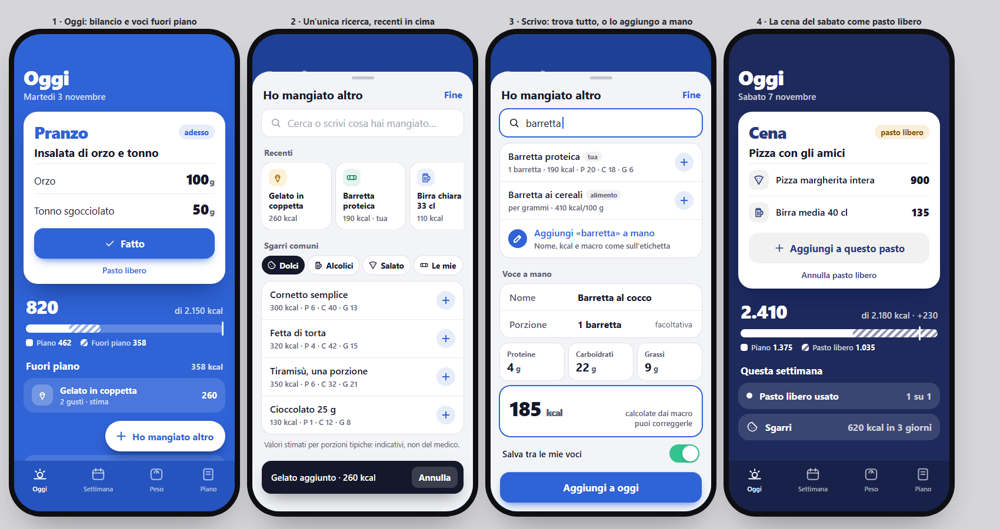

# Fuori piano e pasto libero — design

Data: 2026-11-03 · Stato: approvato in chat, da pianificare



## 1. Obiettivo

Segnare in pochi secondi quello che si mangia fuori dal piano del Dott. Occhino
(sgarri, voci proprie, alimenti a grammi) e il pasto libero settimanale, per
vedere il conto delle kcal del giorno e della settimana.

**Detto dall'utente**
- Dopo uno sgarro l'app **mostra solo il conto**: niente suggerimenti per
  rientrare, niente compensazioni sui giorni dopo.
- Inserimento sia a **voce intera** (catalogo sgarri o voci proprie) sia per
  **grammi** di un alimento del catalogo dell'app.
- In questo giro entra anche il **pasto libero settimanale**, che
  **sostituisce** il pasto del piano: nei totali entra quello che si scrive di
  aver mangiato, o niente.
- Il design dell'interfaccia è quello del mockup qui sopra.

**Fuori da questo giro:** scambi del medico che contano nei totali, grammi
diversi dal piano, import delle voci proprie della v1 (`piano11-miei`), acqua e
integratori, promemoria.

**Criteri di successo**
- Da Oggi, una voce del catalogo o recente si segna in **2 tocchi** (pulsante,
  voce); una voce nuova a mano in meno di 30 secondi.
- Il totale del giorno distingue sempre piano, fuori piano e pasto libero.
- Tutti i valori fuori piano sono marcati come stime, mai come calcoli del medico.
- Database e backup esistenti passano alla nuova versione senza perdite.

## 2. Dati

### 2.1 Tipi (`src/domain/types.ts`)

```ts
// Origine di una voce fuori piano.
export type ExtraOrigin = 'catalogo' | 'mia' | 'alimento' | 'manuale';

// Voce propria salvata e riutilizzabile.
export interface CustomItem {
  id: string;
  name: string;
  portion: string;      // descrizione libera, '' se assente (es. "1 barretta")
  macro: Macro;         // kcal sempre presente; p/c/f a 0 se non indicati
  createdAt: string;    // ISO
}

// Voce mangiata in un giorno. I valori sono copiati al momento:
// modificare o eliminare la voce d'origine non cambia i giorni passati.
export interface ExtraLog {
  id: string;
  date: string;         // YYYY-MM-DD
  name: string;
  portion: string;      // es. "2 gusti", "40 g", ''
  qty: number;          // >= 1, per voci ripetute (×2)
  macro: Macro;         // valori di UNA porzione
  origin: ExtraOrigin;
  refId: string | null; // id del catalogo, della CustomItem o del Food
  grams: number | null; // solo per origin 'alimento'
  freeSlot: Slot | null;// pasto libero a cui appartiene, null = sgarro
  createdAt: string;
}

// MealLog esistente, con un campo nuovo facoltativo.
export interface MealLog {
  date: string;
  slot: Slot;
  planId: string;
  kind?: 'libero';      // assente = pasto del piano (dati esistenti invariati)
}
```

### 2.2 Catalogo sgarri (`src/domain/extras-catalog.ts`)

Voci a porzione, con `category: 'Dolci' | 'Alcolici' | 'Salato'` e un'icona
Phosphor per categoria. Valori ripresi dalla v1 (stime per porzioni tipiche):

| Categoria | Voce | kcal | P | C | G |
|---|---|---|---|---|---|
| Alcolici | Birra chiara 33 cl | 110 | 1 | 9 | 0 |
| Alcolici | Birra media 40 cl | 135 | 1,2 | 11 | 0 |
| Alcolici | Birra doppio malto 33 cl | 280 | 2 | 22 | 0 |
| Alcolici | Bicchiere di vino 125 ml | 90 | 0 | 1 | 0 |
| Alcolici | Spritz | 170 | 0 | 16 | 0 |
| Alcolici | Amaro o superalcolico 40 ml | 95 | 0 | 4 | 0 |
| Dolci | Gelato in coppetta, 2 gusti | 260 | 4 | 32 | 12 |
| Dolci | Cono gelato | 300 | 5 | 36 | 15 |
| Dolci | Tiramisù, una porzione | 350 | 6 | 32 | 21 |
| Dolci | Fetta di torta | 320 | 4 | 42 | 15 |
| Dolci | Cioccolato 25 g | 130 | 1 | 12 | 8 |
| Dolci | Cornetto semplice | 300 | 6 | 40 | 13 |
| Dolci | Cornetto farcito | 400 | 6 | 50 | 19 |
| Salato | Pizza margherita intera | 900 | 35 | 120 | 30 |
| Salato | Trancio di pizza | 300 | 12 | 40 | 10 |
| Salato | Patatine fritte, porzione | 470 | 5 | 55 | 25 |
| Salato | Hamburger semplice | 500 | 25 | 40 | 25 |
| Salato | Panino con salumi | 450 | 20 | 45 | 21 |
| Salato | Patatine in busta 50 g | 270 | 3 | 25 | 17 |
| Salato | Aperitivo con stuzzichini | 450 | 10 | 45 | 25 |

### 2.3 Database (`src/db/schema.ts`)

`this.version(2).stores({ extras: 'id, date', customItems: 'id, name' })`,
con le tabelle della versione 1 invariate. Nessuna funzione `upgrade`: i
`MealLog` esistenti senza `kind` valgono come pasti del piano.

### 2.4 Backup (`src/db/backup.ts`)

Versione **3**: aggiunge `extras` e `customItems`. `parseBackup` accetta anche
la versione 2 (le due liste mancano e diventano vuote); il riepilogo
dell'import mostra anche il numero di voci fuori piano.

## 3. Calcoli (`src/domain/extras.ts`, con test)

- `kcalFromMacros(p, c, f) = round(4p + 4c + 9f)`.
- `extraTotal(e) = macro × qty`; `sumExtras(list)`.
- `foodExtraMacro(food, grams)` = `portionMacro` esistente.
- `dayBalance(meals, done, frees, extras, foods)` restituisce:
  - `planned`: macro di tutti i pasti del piano del giorno;
  - `fromPlan`: pasti segnati fatti, **esclusi** quelli liberi;
  - `free`: voci con `freeSlot` non nullo;
  - `offPlan`: voci con `freeSlot` nullo (sgarri);
  - `total = fromPlan + free + offPlan`;
  - `delta = total.kcal − planned.kcal`.
- `weekSummary(dates, …)`: kcal di sgarri, kcal dei pasti liberi, numero di
  pasti liberi usati nella settimana ISO (il medico ne prevede **1**).
- `recentItems(extras, customItems, limit = 8)`: voci distinte più recenti, per
  nome e origine, dalla più recente.
- `searchExtras(query, catalog, customItems, foods)`: risultati unici da tre
  fonti, ordinati: voci proprie, catalogo sgarri, alimenti; confronto senza
  accenti e maiuscole.
- `validateExtra(input)`: nome non vuoto, kcal tra 0 e 5000, macro ≥ 0,
  grammi > 0 per gli alimenti; messaggi in italiano per campo.

## 4. Stato (`src/state/extras.svelte.ts`)

File separato da `app.svelte.ts` (che resta sotto le 200 righe). Espone
`extras`, `customItems`, e i metodi `add(entry)`, `remove(id)` (con
ripristino per l'annulla), `bumpQty(id)`, `saveCustom(item)`,
`deleteCustom(id)`, `markFree(date, slot)`, `unmarkFree(date, slot)`.
`unmarkFree` riporta il pasto a "da fare" e trasforma le voci di quel pasto in
sgarri (`freeSlot = null`), senza cancellarle. Il pasto libero si salva come
`MealLog` con `kind: 'libero'` tramite `repos`.

## 5. Interfaccia

Componenti nuovi, ciascuno sotto le 200 righe:

- `ui/BalanceBar.svelte` — barra del bilancio sul fondo colorato: parte piena =
  dal piano, parte rigata = fuori piano / pasto libero, tacca = kcal del piano;
  se il totale supera il piano la barra arriva in fondo e la tacca resta al suo
  posto. Legenda sotto con le due cifre. Nessun colore d'allarme.
- `ui/Fab.svelte` — pulsante fisso "Ho mangiato altro" in basso a destra,
  sopra la tab bar, solo in Oggi e nella vista di un giorno. Il contenuto della
  pagina ha spazio sotto per non restare coperto.
- `screens/extras/AddExtraSheet.svelte` — il foglio: ricerca unica
  ("Cerca o scrivi cosa hai mangiato…"); a ricerca vuota, **Recenti** in
  schede orizzontali e **categorie** (Dolci, Alcolici, Salato, Le mie) con
  l'elenco sotto; un tocco su "+" aggiunge e mostra il Toast "… aggiunto ·
  Annulla". Scrivendo: risultati dalle tre fonti con etichetta d'origine
  (tua, alimento) e in fondo "Aggiungi «…» a mano". Nota fissa: "Valori
  stimati per porzioni tipiche: indicativi, non del medico."
- `screens/extras/ExtraForm.svelte` — voce a mano: nome, porzione
  (facoltativa), proteine/carboidrati/grassi, kcal calcolate dai macro ma
  modificabili, interruttore "Salva tra le mie voci" (attivo di default),
  pulsante "Aggiungi a oggi" (o "Aggiungi a questo pasto").
- `screens/extras/FoodGramsForm.svelte` — alimento del catalogo: grammi con
  kcal in diretta.
- `screens/extras/ExtraList.svelte` — sezione "Fuori piano" in Oggi: righe
  velate sul fondo con icona di categoria, nome, porzione/origine, `×n`, kcal;
  tocco → foglio con quantità (− / +) ed "Elimina" (con Annulla).

Modifiche a schermate esistenti:

- **DayView**: `BalanceBar` sotto la striscia del giorno al posto della riga
  kcal/macro attuale. Toccando la barra si apre un foglio con proteine,
  carboidrati e grassi del giorno divisi in piano, fuori piano e totale, così i
  macro non spariscono da Oggi;
  `ExtraList` dopo i pasti; `Fab`.
- **MealCard**: sotto "Fatto" il link "Pasto libero". Da libero: etichetta
  "pasto libero", elenco delle voci di quel pasto, "Aggiungi a questo pasto",
  "Annulla pasto libero". Nella `DayStrip` il segmento di un pasto libero è
  rigato.
- **Settimana**: per ogni giorno "+kcal" fuori piano accanto ai pasti fatti;
  sotto l'aderenza "Pasto libero: n su 1" e "Sgarri: kcal in n giorni". Un
  secondo pasto libero nella settimana mostra l'avviso "Il piano ne prevede
  uno a settimana", senza bloccare.
- **Backup**: conteggi delle voci nel riepilogo dell'import.

Tutto segue `DESIGN.md` ("Colore dell'ora"): fondo nel colore dell'ora, schede
bianche, testo e icone Phosphor, rigato bianco su fondo per le parti fuori piano.

## 6. Casi limite

- Voce a mano: richiesti nome e kcal; macro facoltativi. Errori in linea
  accanto al campo.
- Giorni futuri: non si possono aggiungere voci; i giorni passati sì (dalla
  vista del giorno aperta da Settimana).
- Voce propria modificata o eliminata: i giorni passati non cambiano.
- Annulla dopo eliminazione: 5 secondi, come per le pesate.
- Pasto libero annullato: il pasto torna da fare; le sue voci diventano sgarri.
- Pasto libero su un pasto già fatto: diventa libero (il `MealLog` cambia `kind`).
- Nessun piano attivo: "Ho mangiato altro" resta disponibile; il bilancio
  mostra solo il fuori piano.

## 7. Test

- **Dominio** (`extras.test.ts`): `kcalFromMacros`, `dayBalance` (piano,
  sgarri, pasto libero escluso dal piano, delta), `weekSummary` (conteggio
  pasti liberi su settimana ISO), `recentItems`, `searchExtras` (accenti,
  ordine delle fonti), `validateExtra`.
- **DB** (fake-indexeddb): aggiornamento da versione 1 a 2 con dati esistenti;
  round-trip del backup v3; import di un backup v2.
- **Schermate**: aggiungere uno sgarro dal catalogo e vederlo nel bilancio;
  aggiungere una voce a mano con kcal calcolate; segnare e annullare un pasto
  libero.
- **Verifica**: `npm run check` a 0, `npm test` verde, autofixer sui `.svelte`
  toccati, screenshot a 375×812 in chiaro e scuro (pranzo, colazione, cena).
