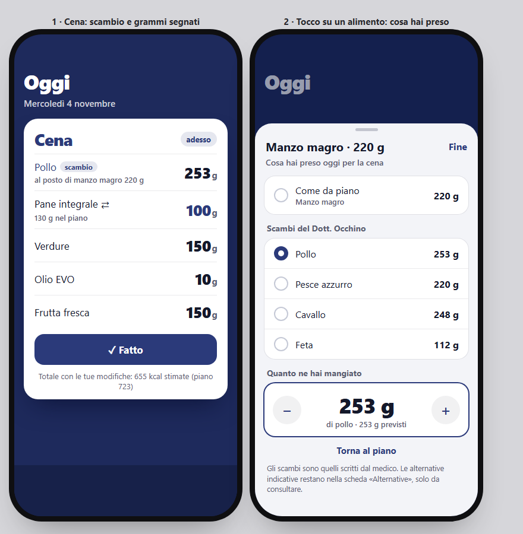

# Scambi del medico e grammi reali — design

Data: 2026-11-03 · Stato: approvato in chat («Sì, procedi»), da realizzare



## 1. Obiettivo

Poter segnare, pasto per pasto e giorno per giorno, che di un alimento si è
preso uno **scambio del Dott. Occhino** e/o una **quantità diversa** dal
piano, così che i totali del giorno e della settimana usino quello che si è
mangiato davvero. Il piano non cambia mai.

**Detto dall'utente**
- Solo gli scambi scritti dal medico; le alternative indicative restano da
  consultare.
- Cambiare scambio o grammi **non** segna il pasto fatto: si preme «Fatto».
- Insieme si chiudono i rilievi minori rimasti dal fuori piano (§6).

**Criteri di successo**
- Da Oggi, uno scambio si segna in 2 tocchi (alimento, scambio).
- La scheda del pasto mostra lo scambio («al posto di …») e i grammi diversi
  dal piano («… g nel piano»).
- Database e backup passano alla nuova versione senza perdite.

## 2. Dati

```ts
// Cosa si è preso al posto di un alimento del piano, in un giorno.
export interface ItemLog {
  date: string;       // YYYY-MM-DD
  slot: Slot;
  index: number;      // posizione dell'alimento nel pasto del piano
  planFoodId: string; // l'alimento del piano a cui si riferisce (controllo)
  foodId: string;     // quello preso: lo stesso del piano o uno dei suoi scambi
  grams: number;      // > 0
}
```

- Dexie **versione 4**: `itemLogs: '[date+slot+index], date'`.
- Se l'alimento del piano in quella posizione non è più `planFoodId` (piano
  modificato), il log si ignora.
- Un log uguale al piano (stesso alimento, stessi grammi) non si salva: si
  cancella.
- Backup **versione 4** con `itemLogs`; si importano ancora le versioni 2 e 3
  (lista vuota).

## 3. Calcoli (`src/domain/eaten.ts`, con test)

- `interface EatenItem { index; foodId; grams; planFoodId; planGrams; swapped: boolean; changed: boolean }`
  (`swapped` = alimento diverso dal piano; `changed` = grammi diversi da quelli
  previsti per l'alimento scelto).
- `choiceGrams(item: PlanItem, foodId: string): number | null` — grammi previsti
  per il piano o per uno scambio; `null` se `foodId` non è né l'uno né l'altro.
- `eatenItems(meal: Meal, logs: readonly ItemLog[], date: string): EatenItem[]`.
- `eatenMealMacro(meal, logs, date, foods): Macro`.
- `dayBalance` riceve un ultimo argomento `itemLogs` (default `[]`): `fromPlan`
  usa i macro di `eatenMealMacro`; `planned` resta il piano.

## 4. Stato (`src/state/eaten.svelte.ts`)

`eatenState.itemLogs`, `load()`, `forDate(date)`, `set(date, slot, index, item, foodId, grams)`
(cancella il log se coincide con il piano), `reset(date, slot, index)`.
Caricato dentro `app.load()` prima di `ready` insieme alle voci fuori piano.

## 5. Interfaccia

- **Foglio dell'alimento** (`SubsSheet`, ora con `target: { date, slot, index, item }`):
  - titolo «{alimento} · {grammi}», sottotitolo «Cosa hai preso oggi per {pasto}»;
  - scheda **Dott. Occhino**: «Come da piano» e gli scambi come scelta singola;
    sotto «Quanto ne hai mangiato» con − / + a passi di 5 g e campo numerico
    (virgola ammessa); «Torna al piano»;
  - scheda **Alternative**: invariata, solo consultazione (solo se ce ne sono);
  - si apre toccando **qualsiasi** alimento del pasto (non più solo quelli con ⇄).
- **Scheda del pasto**: nome dell'alimento preso; pillola «scambio» e riga
  «al posto di {piano} {g}» per uno scambio; «{g} nel piano» se i grammi sono
  diversi; in fondo «{kcal} kcal stimate» e, se ci sono modifiche, «(piano {kcal})».
- **Totali**: Oggi e Settimana usano `dayBalance` con gli `itemLogs`.

## 6. Rilievi minori dal fuori piano

1. `restore` e `unmarkFree` uniscono una voce a una riga uguale già presente
   (somma delle quantità) invece di crearne una seconda.
2. Voce a mano e alimento a grammi mostrano «… aggiunto · Annulla».
3. Senza piano attivo la barra del bilancio nasconde «di … kcal», lo scarto e
   «Piano»; la nota sulle stime compare quando ci sono voci.
4. La barra del bilancio ha un `aria-label` con i numeri.
5. Un solo avviso alla volta: stato condiviso `state/toast.svelte.ts` e un solo
   `Toast` in `App.svelte`.
6. Voci fuori piano e `itemLogs` si caricano dentro `app.load()` prima di `ready`.
7. Riepilogo dell'import: «Pasti fatti» senza i liberi, più «Pasti liberi».
8. `weekSummary` conta come pasto libero solo una voce con il `MealLog` libero
   corrispondente (come `dayBalance`).

## 7. Test

Dominio (`eaten.test.ts`: `choiceGrams`, `eatenItems` con log valido, uguale
al piano, orfano; `eatenMealMacro`; `dayBalance` con itemLogs; `weekSummary`
con voce orfana), DB (upgrade 3→4, backup v4, import v3), stato (`set` uguale
al piano cancella; merge in `restore`/`unmarkFree`), schermate (scambio dal
foglio e scheda aggiornata; grammi con la virgola; toast per voce a mano; barra
senza piano). Verifica a 375×812 in chiaro e scuro.
